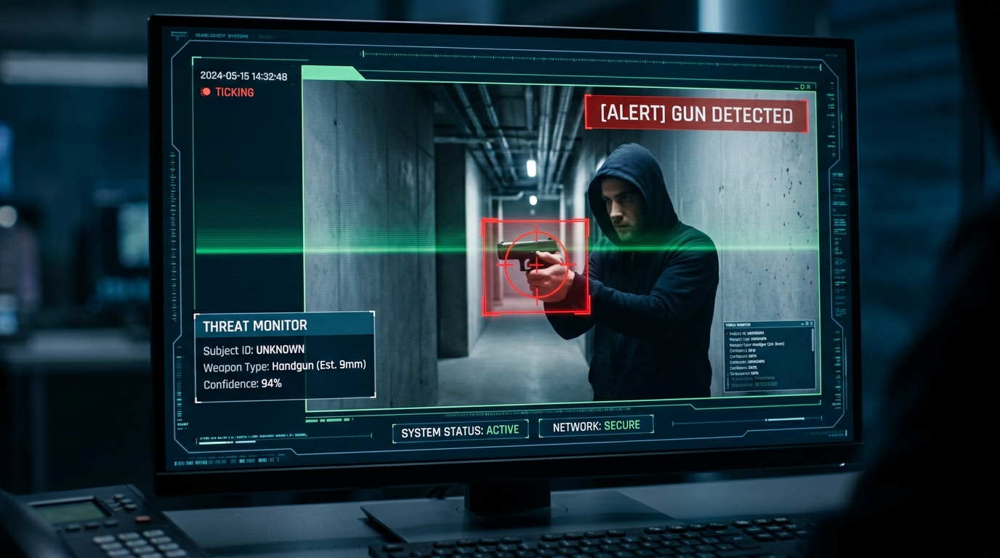

# Real-Time Gun Detection System

An OpenCV and YOLO-based application for detecting guns in live webcam feeds or recorded video files. The active detector uses a trained YOLO model and explicitly filters its output to gun class detections.

---

## 📌 Project Overview

This system monitors video input frame-by-frame, processes the image using feature extraction, and identifies potential guns. Upon detection, it overlays visual alert banners, places red bounding boxes around the object, and logs live status updates.



---

## 🛠️ How It Works

```
┌─────────────────┐    ┌───────────────────┐    ┌─────────────────────┐
│   Video Input   │───>│  Pre-processing   │───>│  YOLO Gun Filter    │
│ (Webcam / File) │    │ (Resize + Color)  │    │ (gun class only)    │
└─────────────────┘    └───────────────────┘    └─────────────────────┘
                                                           │
                                                           ▼
┌─────────────────┐    ┌───────────────────┐    ┌─────────────────────┐
│  Display Window │<───│ UI Visual Overlay │<───│ Bounding Box Draw   │
│(OpenCV imshow)  │    │(Status + Timestamp│    │  (Red Boxes + Tags) │
└─────────────────┘    └───────────────────┘    └─────────────────────┘
```

### 1. Model Loading & Initialization
- The program loads [`gun_detector.pt`](gun_detector.pt), a YOLO11 model trained for gun and knife detection.
- By default, it loads `gun_detector.pt` from beside the script. A different model can be supplied with `--model`.
- The model's `gun` class is explicitly selected for inference. Knife detections and all other classes are ignored.

### 2. Video Capture & Frame Pre-processing
- **Source Selection**: Connects to the default webcam (`Camera 0`) or opens a specified video file via command-line arguments.
- **Resizing**: Each frame is resized to a standard width of `650px` using OpenCV while preserving aspect ratio.
- **Detection Input**: Runs YOLO inference on each resized color frame and accepts gun boxes at or above the confidence threshold (default `0.60`).

### 3. Gun-Only Detection
- Runs the YOLO model with `--confidence` (default `0.60`) and passes only the model class named `gun` or `firearm` to inference. The included model's knife class cannot trigger a box, alert, sound, or snapshot.
- The included model card reports test precision of 0.970 and recall of 0.959 for its gun class on its own held-out dataset. These are upstream results, not a guarantee of accuracy on this webcam or footage. The publisher describes it as an academic demonstration model, not a safety-critical detector.
- Visual lookalikes can still cause false positives, and small or obscured guns can be missed. Validate and tune the confidence threshold on representative footage.

### 4. UI Annotations, Alerts & Snapshot Collection
- **Bounding Boxes**: Draws a bright red rectangle (`(0, 0, 255)`) around detected guns with a `GUN DETECTED (count)` header tag.
- **Terminal Alert Log**: Prints real-time alert messages to the console with timestamp and detection count whenever a firearm is spotted:
  ```text
  [ALERT] 🚨 2026-08-23 02:12:15 | THREAT DETECTED: 1 Gun(s) Spotted in feed!
  [SUCCESS] 📸 Saved detection snapshot: 'detections/gun_alert_20260823_021215_count1.jpg'
  ```
- **Audio Alarm**: On Windows, plays the configured `SystemExclamation` warning sound and a short 1500 Hz backup beep when a gun is detected. Alerts are rate-limited to once per second while detection continues. Use `--no-sound` to disable both sounds.
- **Automatic Image Capture**: Saves annotated snapshots at the processing resolution into the `detections/` folder with timestamped file names (e.g., `gun_alert_20260823_021215_count1.jpg`). Features a configurable cooldown to prevent redundant disk usage and reports write failures.
- **Status Banner**:
  - **`[ALERT] X GUN(S) SPOTTED!`** in **RED** with **`📸 Snapshot Saved to File!`** indicator overlay.
  - **`[NORMAL] System Monitoring`** in **GREEN** when clear.

---

## ⚙️ Prerequisites & Installation

### Requirements
- **Python**: 3.8+
- **OpenCV**: `opencv-python`
- **Ultralytics**: `ultralytics` (installs PyTorch for YOLO inference)

### Installation
Run the following command to install required packages:

```bash
pip install -r requirements.txt
```

---

## 🚀 How to Run

### 1. Run with Live Webcam (Default)
```bash
python "gun detection.py"
```

### 2. Run with Custom Output Folder & Cooldown Interval
```bash
python "gun detection.py" -o "alert_snapshots" --cooldown 3.0
```

### 3. Run on a Video File
```bash
python "gun detection.py" -v "path/to/sample_video.mp4"
```

### Command Line Options
| Flag | Long Flag | Description | Default |
|---|---|---|---|
| `-m` | `--model` | Path to a YOLO model with a `gun` or `firearm` class | `gun_detector.pt` beside the script |
| `-v` | `--video` | Path to input video file | `None` (Webcam) |
| `-o` | `--output` | Folder directory to save snapshot images | `detections` |
| `--cooldown` | `--cooldown` | Minimum seconds between snapshot image recordings | `2.0` |
| | `--confidence` | Minimum gun detection confidence (0 to 1) | `0.60` |
| `--no-sound` | `--no-sound` | Disable both audio alerts | `False` |
| `-h` | `--help` | Display command-line usage help | - |

---

## 📂 Code Structure

The detection loop in [`gun detection.py`](gun%20detection.py) runs YOLO inference restricted to the model's `gun`/`firearm` class. The included `gun_detector.pt` is based on [cosgun99/gun-knife-yolo11n](https://huggingface.co/cosgun99/gun-knife-yolo11n), whose model card reports gun precision 0.970 and recall 0.959 on its test set. It may still produce false positives on new scenes, so check its output on your own footage.
